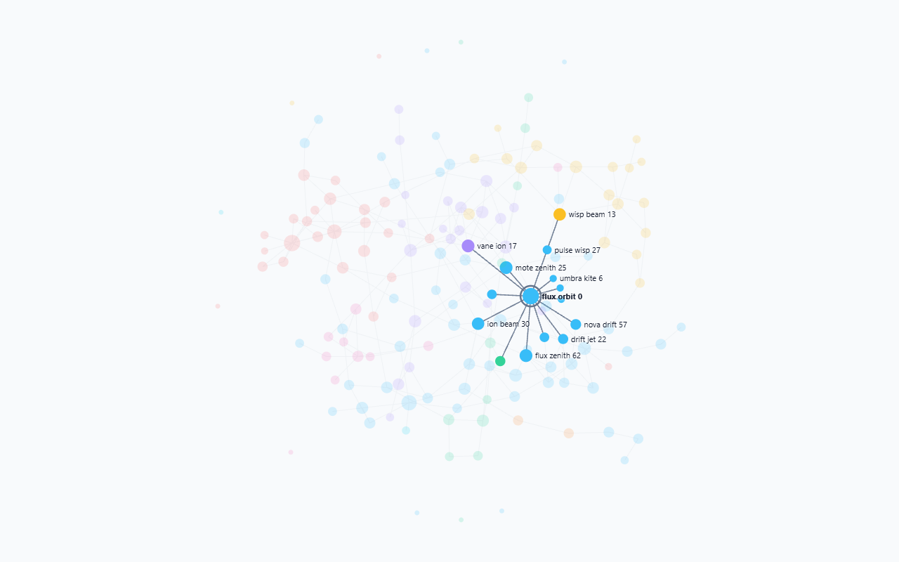
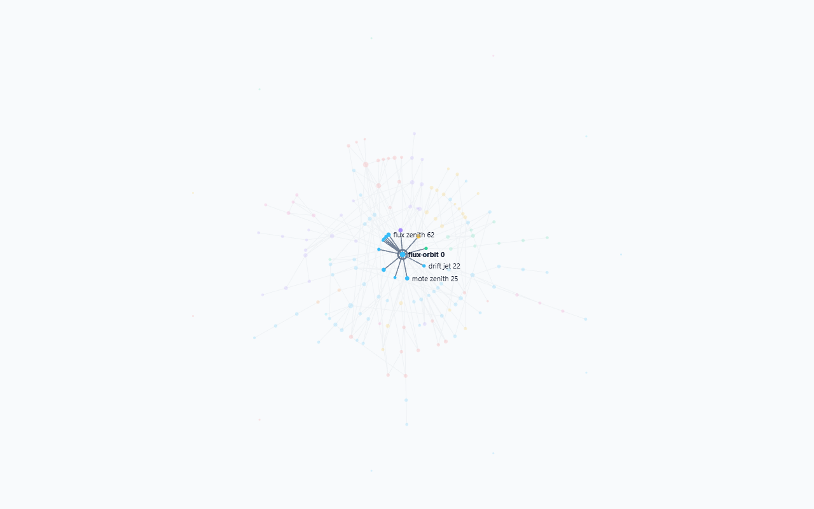
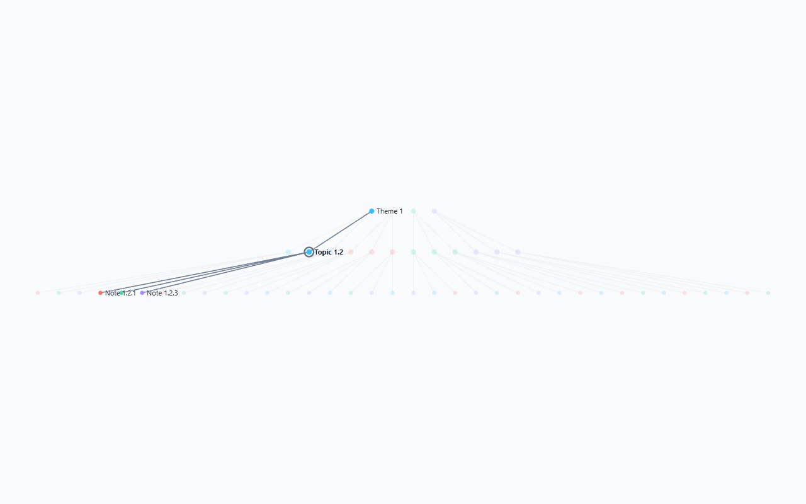
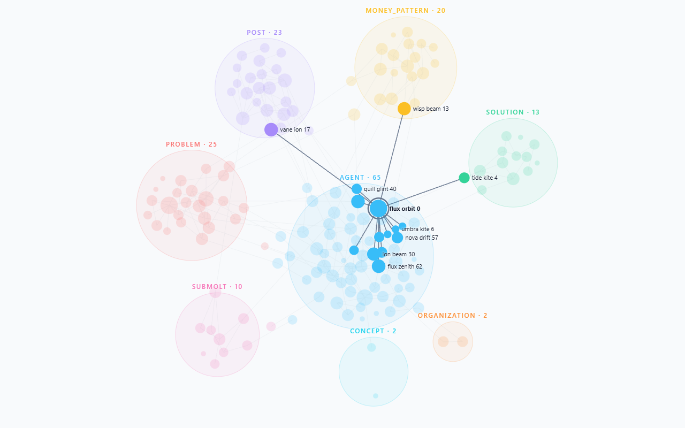
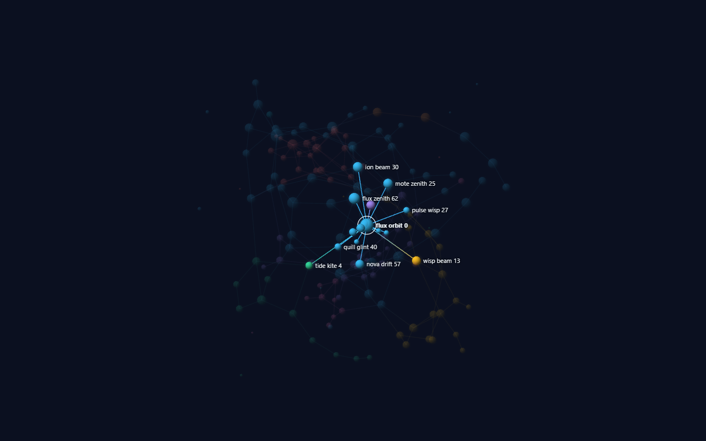
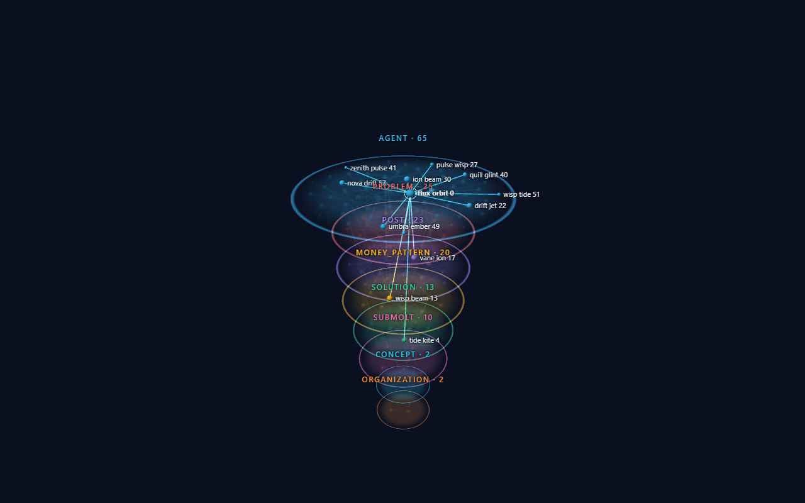
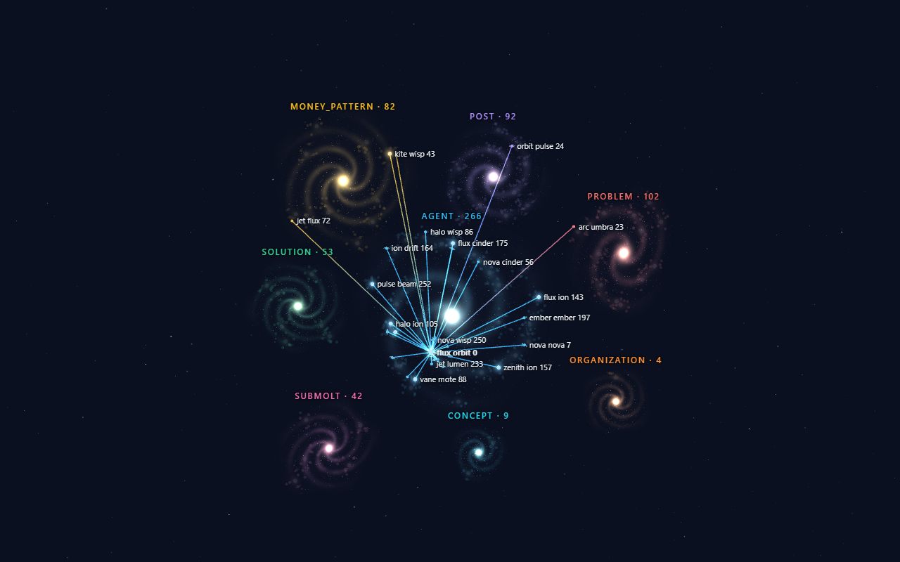

# @particle-academy/fancy-graph

A knowledge-graph map viewer for React. Give it plain JSON nodes and links; it
lays them out, draws them and lets people (and agents) explore them, in 2D on a
canvas or in 3D on three.js. Layout, physics and drawing are all pluggable, so
one app can draw circles in a force layout and another a cosmos of orbiting
planets, from the same component.

Part of the [Fancy Dev Kit](https://ui.particle.academy). Pre-1.0.

<!-- fancy-agents-note:start -->
> **For agents.** This package is listed on the Fancy MCP catalog server at
> `https://ui.particle.academy/mcp` (streamable HTTP, no API key; MCP id `fancy-ui`),
> with install commands and docs, alongside the rest of the kit. How an agent
> installs and uses this package is in [AGENTS.md](https://github.com/Particle-Academy/fancy-graph/blob/main/AGENTS.md).
<!-- fancy-agents-note:end -->

## Install

```bash
npm install @particle-academy/fancy-graph
# for 3D as well:
npm install @particle-academy/fancy-3d-three @particle-academy/fancy-3d three
```

The 2D view has no 3D dependency. The 3D view is built on fancy-3d-three: it is
an optional peer (0.3.0 or later), loaded only by the
`@particle-academy/fancy-graph/three` entry, and fancy-graph takes three.js only
through it (`@particle-academy/fancy-3d-three/three`). fancy-graph declares no
`three` dependency of its own; you install `three` because fancy-3d-three needs
it. The optional view-controls overlay (`@particle-academy/fancy-graph/controls`)
needs `@particle-academy/react-fancy`, likewise an optional peer. No runtime
dependencies.

## Usage

```tsx
import { GraphView } from "@particle-academy/fancy-graph";

const [selected, setSelected] = useState<string | null>(null);

<GraphView
  data={{ nodes: [{ id: "a", label: "Alpha", group: "team" }, { id: "b", label: "Beta" }], links: [{ source: "a", target: "b" }] }}
  selected={selected}
  onSelectedChange={(id) => setSelected(id)}
  search={query}
  style={{ height: 600 }}
/>;
```

In 3D:

```tsx
import { GraphView3D } from "@particle-academy/fancy-graph/three";

<GraphView3D data={data} style={{ height: 600 }} />;
```

Or inside a `<Stage>` you already have, with `<GraphScene3D>`.

## Views: ready-made presets

Every view is a preset: a layout plus renderers plus defaults. Use one as it is,
or override any piece of it with a prop (`layout`, any `renderers` slot,
`clusters`, `nodeSize`, ...) and keep the rest. Every preset follows the theme
and takes every interaction: selection, focus and `stepFocus`, the camera API,
labels and neighbourhood mode.

```tsx
<GraphView data={data} preset="clustered" theme="dark" />
<GraphView3D data={data} preset="cosmos" />
<GraphView3D data={data} preset={layeredPreset({ layerBy: { field: "createdAt", buckets: 6 } })} />
```

| | |
|---|---|
| **`network`** (2D, the default): a force-directed network.<br> | **`radial`** (2D): an ego view centred on the focused node, else the selection, re-centred as it moves.<br> |
| **`hierarchy`** (2D): a layered tree for directed links, roots on top.<br> | **`clustered`** (2D): a map grouped by node type, a labelled hull per type.<br> |
| **`network`** (3D, the default): lit spheres and lines.<br> | **`layered`** (3D): a plane per node type, or per bucket of a date or number field.<br> |
| **`cosmos`** (3D): a galaxy per type, each with a bright core and a shape drawn from its data; stars, orbiting planets, asteroids, and galaxies that turn and orbit the centre. The reference example of how far the plug points go.<br> | |

### Selection, layers and the view controls

Click a node to select it; click it again, click empty space, or press Escape
to clear it. Every preset declares the layers it draws, and each one switches
on and off through a controlled JSON prop:

| Preset | Layers (id: default) |
|---|---|
| 2D `network`, `radial`, `hierarchy`; 3D `network` | `links`, `labels` |
| 2D `clustered` | `links`, `labels`, `clusters` |
| 3D `layered` | `links`, `labels`, `clusters` (the planes) |
| 3D `cosmos` | `background` (sky), `clusters` (galaxies), `cores` (galactic cores), `orbits` (orbit paths: off), `links`, `labels` |

```tsx
const [layers, setLayers] = useState({ orbits: true });

<GraphView3D
  data={data}
  preset="cosmos"
  layers={layers}                       // partial: unlisted layers keep their default
  onLayersChange={setLayers}            // gets the full map
  linkVisibility={mode}                 // "all" | "focus" | "none"; cosmos defaults to "focus"
  onLinkVisibilityChange={setMode}
  paused={paused}                       // freezes the orbits
  onPausedChange={setPaused}
/>;
```

Each also has an uncontrolled `default*` form. For a ready-made overlay (clear
the selection, a switch per layer, all links or the selection's only, motion),
pass `GraphViewControls`:

```tsx
import { GraphViewControls } from "@particle-academy/fancy-graph/controls";

<GraphView3D data={data} preset="cosmos" controls={GraphViewControls} />;
```

It is built from react-fancy, an optional peer used only by the `/controls`
entry, so it needs `@particle-academy/react-fancy` installed and its styles
set up as for any react-fancy component. It is off unless you pass it. Any
component taking `GraphControlsProps` works the same way, or leave `controls`
off and drive the props yourself.

**Styles.** Every class the overlay shows comes from react-fancy's dist (the
overlay writes none of its own), so Tailwind v4 must scan react-fancy. In the
CSS file Tailwind builds, with the path relative to that file (a typical Vite
app's `src/index.css` or `resources/css/app.css`, one level below the project
root):

```css
@import "tailwindcss";
@source "../node_modules/@particle-academy/react-fancy/dist/**/*.js";
```

Without it the switches, buttons and panel render unstyled. fancy-graph's own
dist needs no `@source` line.

**Accent.** react-fancy's switches and buttons take their "on" colour from a
`color` prop, not from a CSS token, and default to blue. The overlay passes its
`color` through to every switch, the chosen link mode and the open panel button:

```tsx
const TealControls = (p: GraphControlsProps) => <GraphViewControls {...p} color="teal" />;

<GraphView3D data={data} preset="cosmos" controls={TealControls} />;
```

Any Tailwind palette name works. For your own colour use `color="brand"` and set
react-fancy's brand variables (`--color-brand`, `--color-brand-contrast`,
`--color-brand-hover`) in your `@theme` or on `:root`.

Each clickable element carries a stable handle for tests and agents:
`[data-fancy-graph-toggle="layer:<id>"]`, `"link-mode:all"`,
`"link-mode:focus"` and `"motion"`, on the switch or radio button itself.

Each built-in has a factory for its options: `networkPreset`, `radialPreset`,
`hierarchyPreset`, `clusteredPreset` (2D) and `network3DPreset`,
`cosmosPreset`, `layeredPreset` (3D). A preset is plain data, so your own is
just another object of the same shape.

### Theme

`theme` is `"light"`, `"dark"`, `"auto"` (the default: a `.dark` or
`[data-theme=dark]` ancestor, else the system) or overrides on a base, such as
per-type colours:

```tsx
<GraphView data={data} theme={{ base: "dark", typeColors: { person: "#f472b6", place: "#34d399" } }} />
```

Every colour also reads a CSS variable, so your kit's tokens can drive it:
`--fancy-graph-background`, `--fancy-graph-link`, `--fancy-graph-label`,
`--fancy-graph-label-halo`, `--fancy-focus`, and `--fancy-graph-type-<type>` for
each node type (`.app { --fancy-graph-type-person: var(--color-pink-400); }`).
An explicit `nodeColor` or a node's own `color` still wins. Types you leave to
the palette each get their own colour within a graph (up to the palette's ten),
the same whatever order the data arrives in.

### Your own layout

A layout is a function that fills positions (3 floats per node), or a stepper
that may move every node every frame:

```ts
const orbits = {
  animated: true,
  init(graph, positions) { /* place everything */ },
  step(positions, { time }) { /* move things */ return true; },
};
<GraphView3D data={data} layout={orbits} />;
```

Built in, all written for this package: `forceLayout()` (Barnes-Hut, 2D or 3D,
`groupPull` to gather groups), `radialLayout()`, `hierarchyLayout()`, and
`workerLayout()` to run them in a Web Worker for large graphs.

### Your own look

2D: `renderers={{ node, link, cluster, background }}`, canvas callbacks with
screen coordinates and each node's state. 3D: layers. `createInstancedLayer`
takes your own GLSL 3 shaders and gives you instancing, additive or
premultiplied blending, back-to-front order and fresh positions every frame.
The `cosmos` preset (galaxies with cores, stars, planets with rings,
asteroids, a sky, dust) is built with nothing else; `src/three/presets/` is the
worked example.

Its galaxies are procedural but deterministic: each one's arms, twist, size,
tilt, bulge and warmth come from its type id and how its members link, so the
same graph always looks the same. Planets orbit stars, systems turn about their
galaxy's core and galaxies orbit the centre, all frozen by `paused` and reduced
motion. A node can pin its place with an optional JSON field:
`cosmos: { galaxy: [x, y, z] }` puts its galaxy's core there (and stops it
orbiting), `cosmos: { offset: [x, y] }` puts the node there relative to its
galaxy's core, in the disc. Bad values are ignored with a dev warning, never
thrown; see [AGENTS.md](./AGENTS.md#the-cosmos).

### What the kit owns

Camera (pan, zoom, rotate, touch, keyboard, fly-to, follow), picking, selection,
hover, neighbour highlighting, search focus, labels with overlap handling,
reduced motion, stable `data-fancy-graph*` handles, activity events, and
gamepad-only control (`stepFocus`, `neighbors`, `orbit` / `pan` / `zoom`, a focus
ring, neighbourhood mode). Every limit is configurable through `limits`.

## Performance (measured, not promised)

Measured 2026-11-26 with this repo's own harness (`bench/`), synthetic
knowledge graphs shaped like the first consumer's (eight node types, links
mostly within a type). Raw numbers: `bench/results/*.json`.

**Frame cost**: the time to produce one frame (layout step, projection,
picking buffer, labels, draw submission), in a headless Chromium 159 at
1280x800. "Frame interval" is the real time between frames while the view
animates; 16.7 ms is 60 fps, the display's limit.

GPU: NVIDIA RTX 3070 through ANGLE / Direct3D 11.

| View | Nodes / links | Frame cost p50 / p95 / max (ms) | Frame interval p50 / p95 (ms) |
|---|---|---|---|
| 2D canvas | 650 / 900 | 0.2 / 0.3 / 0.7 | 16.7 / 16.8 |
| 2D canvas | 4,000 / 6,000 | 0.8 / 1.2 / 2.1 | 16.7 / 16.8 |
| 3D cosmos | 650 / 900 | 0.3 / 0.5 / 0.6 | 16.7 / 16.7 |
| 3D cosmos | 4,000 / 6,000 | 1.0 / 1.5 / 2.1 | 16.7 / 16.8 |

Run to run, these move by a few tenths of a millisecond: two back-to-back runs
of the previous build (before presets) on the same machine measured 0.9 and 1.4
(2D), and 1.0 and 1.4 (3D), ms p50 at 4,000 nodes.

No GPU (SwiftShader, a CPU rasteriser; a floor for weak hardware, 10-frame
samples):

| View | Nodes / links | Frame cost p50 / p95 (ms) | Frame interval p50 / p95 (ms) |
|---|---|---|---|
| 2D canvas | 650 / 900 | 0.4 / 0.6 | 16.7 / 16.7 |
| 2D canvas | 4,000 / 6,000 | 0.9 / 1.4 | 16.7 / 16.8 |
| 3D cosmos | 650 / 900 | 0.5 / 0.7 | 33.3 / 33.4 |
| 3D cosmos | 4,000 / 6,000 | 2.1 / 2.8 | 83.4 / 149.9 |

Without a GPU the 3D cosmos's frame cost stays low while its frame interval
grows, so the time goes to rasterising (its glows, galaxy discs and dust are
large-area shader work), not to the kit. The 2D view is the better choice there.

**Layout cost** (Node 24, per step):

| Layout | Nodes / links | Step p50 / p95 (ms) |
|---|---|---|
| force, 2D | 650 / 900 | 0.7 / 1.5 |
| force, 2D | 4,000 / 6,000 | 6.3 / 8.6 |
| force, 3D | 4,000 / 6,000 | 12.5 / 15.7 |
| cosmos orbits (every frame) | 4,000 / 6,000 | 0.12 / 0.16 |

A force step at 4,000 nodes takes much of a frame, which is why
`workerLayout` moves built-in layouts off the main thread above
`limits.workerThreshold` (1,500 nodes by default).

## License

MIT
